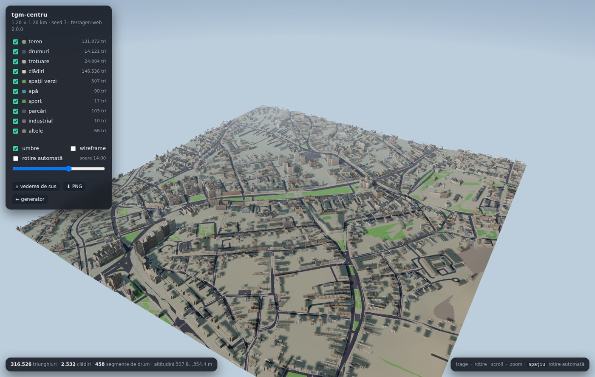
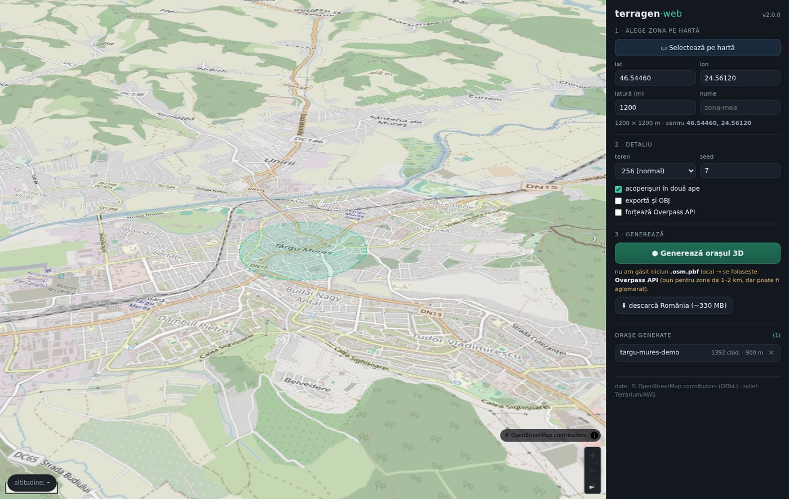

# terragen-web

**Orașe 3D din date reale (OpenStreetMap + model digital al terenului) — generate în browser, fără Unity, fără Blender.**

[](https://github.com/MoraruCatalin93/Generare-Orase-3D/actions/workflows/ci.yml)
[](pyproject.toml)
[](LICENSE)

Selectezi o zonă pe hartă → apeși un buton → primești terenul cu relief, drumurile, trotuarele și
clădirile cu acoperișuri și **ferestre reale** → le vezi imediat în viewer-ul 3D din browser și le
descarci ca **GLB** pentru orice engine.





---

## Pornire rapidă

```bash
git clone https://github.com/MoraruCatalin93/Generare-Orase-3D.git
cd Generare-Orase-3D
./start.sh            # macOS / Linux   (Windows: .\start.ps1)
```

Se deschide **http://127.0.0.1:8777**:

1. **Harta** — centrată pe Târgu Mureș, cu relief 3D. Taste: `t` = relief on/off, `s` = satelit.
2. **„▭ Selectează pe hartă"** — tragi un dreptunghi (sau scrii lat/lon + latura în metri).
3. Alegi detaliul terenului, seed-ul, acoperișurile → **„⬢ Generează orașul 3D"**.
4. Progresul curge în timp real (6 pași) → **„◱ Deschide viewer 3D"**, **ZIP** sau **📂 folder**.

Prima rulare creează `.venv` și instalează dependențele (1–2 minute). Instrucțiuni detaliate, pas cu
pas, în **[CUM-INCEPI.md](CUM-INCEPI.md)**.

### Datele OSM

Fără fișier local, aplicația ia datele din **Overpass API** — merge pentru zone de 1–2 km, dar
serverul public e uneori aglomerat. Pentru viteză, apasă o singură dată în aplicație
**„⬇ descarcă România (~330 MB)"**: de atunci generarea e **offline** și de ~10× mai rapidă.

---

## Ce iese

```
sites/<nume>/
├── manifest.json                 # zonă, sisteme de coordonate, statistici, straturi
├── glb/
│   ├── terrain.glb               #   teren cu relief (culori după altitudine / pantă)
│   ├── roads.glb                 #   carosabil (mesh, lățimi reale din OSM), drapat pe teren
│   ├── sidewalks.glb             #   trotuare, poteci, treceri
│   ├── buildings.glb             #   clădiri + acoperișuri + FERESTRE (textura e în GLB)
│   └── green / forest / water / pitch / parking / industrial / other .glb
├── obj/                          # opțional (bifează „exportă și OBJ")
├── data/roads_network.json       # noduri de intersecție + segmente (trafic / AI / minimap)
└── terrain/terrain_heightmap_257.r16   # heightmap 16 biți (Unity Terrain, Godot, etc.)
```

**Exemplu real** (Târgu Mureș, 1,2 × 1,2 km): 2.532 clădiri · 316.526 triunghiuri · 458 segmente de
drum · altitudini 307,8…354,4 m · ~40 s prin Overpass.

### Cum arată orașul

- **Teren** — DEM Terrarium (~3–5 m/px), vârfuri la ~6 m, culori după altitudine + gri pe pante.
- **Drumuri** — poligoane reale (lățime din `width`/`lanes` sau pe clasă), **drapate pe teren**
  (nu terasate), cu trotuare separate.
- **Clădiri** — înălțime din `height`/`building:levels` sau pe tip; **pereți flat-shaded** (colțuri
  ascuțite, look low-poly), **acoperișuri în două ape** cu streașină, frontoane și hornuri pentru case
  mici; acoperiș plat cu atic + casete tehnice pentru blocuri.
- **Ferestre fără shader** — UV-uri de fațadă (`u = distanță / 3,2 m`, `v = etaj`) + o textură de o
  celulă generată procedural, înmulțită cu culoarea per vertex. Rezultat: **un singur material pentru
  tot orașul**, zero assets, geamuri corecte la orice distanță, în orice engine.

### Sisteme de coordonate

| fișiere | axe | observație |
|---|---|---|
| `glb/*.glb` | X = Est, Y = Sus, Z = **−Nord** | glTF standard (right-handed) |
| `obj/*.obj` | X = Est, Y = Sus, Z = Nord | pentru importatori clasici |
| `roads_network.json` | puncte `[x = Est, y = Sus, z = Nord]` | la ~4 m, reeșantionate |

Originea (0, 0, 0) = centrul zonei, la altitudinea reală a terenului. **1 unitate = 1 metru.**

### Import în alte engine-uri

| engine | cum |
|---|---|
| **three.js / Babylon** | `GLTFLoader` — exact ce face viewer-ul din `terragen/web/viewer/` |
| **Godot 4** | tragi `buildings.glb` în scenă; culori per vertex + textură automate |
| **Unreal 5** | import glTF (Interchange) — materiale PBR simple |
| **Blender** | `File → Import → glTF 2.0`, fără addon-uri |
| **Unity** | `glTFast` + `buildings.glb` (nu mai e nevoie de shader custom) |

---

## Linia de comandă

```bash
python3 -m terragen serve                    # aplicația (hartă + generator + viewer)
python3 -m terragen generate --center targu-mures --size 1500 --out sites/tgm --seed 7
python3 -m terragen build --site sites/tgm --out dist    # site static, cu viewer inclus
python3 -m terragen check                    # verifică instalarea
python3 -m pytest tests -q                   # teste offline (DEM fals, fără rețea)
```

| opțiune `generate` | default | ce face |
|---|---|---|
| `--center` | `targu-mures` | preset sau `lat,lon` (`targu-mures, cluj, brasov, sibiu, bucuresti, oradea, timisoara, berlin, paris`) |
| `--size` | `1500` | latura zonei, în metri |
| `--out` | `sites/oras` | folderul de ieșire |
| `--terrain-res` | `256` | grila de teren (256 → 257 × 257 vârfuri) |
| `--dem-zoom` | `15` | zoom tile-uri DEM |
| `--seed` | `7` | variația de stil (înălțimi, culori) |
| `--obj` | — | exportă și OBJ + MTL |
| `--no-roofs` | — | fără acoperișuri în două ape |
| `--overpass` | — | ignoră fișierul local, ia din Overpass |

`python3 -m terragen build` produce un folder autonom (`index.html` + `vendor/` + datele), care merge
urcat direct pe Netlify / GitHub Pages / orice hosting static.

---

## Cum e construit

```
terragen/
├── project.py    # proiecție locală Transverse Mercator (lon/lat → metri E/N)
├── dem.py        # tile-uri Terrarium → mozaic de altitudini + eșantionare biliniară
├── osmdata.py    # citire .osm.pbf (pyosmium / osmium-tool / cititor intern) sau Overpass
├── pbflite.py    # cititor .osm.pbf în Python pur (fără dependențe)
├── geom.py       # triangulare (earcut, cu găuri), extrudare cu pereți plați, UV de fațadă
├── facade.py     # textura de fereastră generată procedural (PNG, o celulă)
├── build.py      # stilul: lățimi de drum, înălțimi, culori, acoperișuri, straturi
├── export.py     # GLB (cu textură încorporată), OBJ, heightmap RAW16, graf de drumuri
├── cli.py        # pipeline-ul de generare
├── cli_main.py   # punctul de intrare (`serve`, `generate`, `build`, `check`)
├── site.py       # împachetare ca site static
├── server.py     # Flask: API + SSE pentru progres + fișiere
└── web/
    ├── ui/       # harta (MapLibre, local), panoul, selecția zonei
    └── viewer/   # viewer 3D three.js (local, fără CDN)
```

Tot ce ține de „stil" e într-un singur loc, în `build.py`: `BASE_WIDTH` (lățimi pe clasă),
`HEIGHT_DEFAULTS` (înălțimi pe tip), `BUILDING_PALETTE`, `ROOF_COLORS`, `area_kind()`.
Modulele de fațadă: `geom.MODULE_U` (3,2 m) și `geom.FLOOR_H` (3,1 m).

### Dezvoltare

```bash
python3 -m venv .venv && source .venv/bin/activate
pip install -r requirements.txt
pip install ruff pytest
ruff check . && ruff format --check .
pytest -q
```

---

## Limitări (cinstit)

- **Relații multipolygon** OSM sunt ignorate → unele clădiri mari (mall-uri, biserici cu curți) și
  unele păduri/parcuri definite ca `relation` lipsesc.
- **Tuneluri** sărite; **poduri** puse pe teren (pot coborî în albia apei). `bridge=yes` e în JSON.
- **DEM public ~3–5 m/px** — relief corect la scară de oraș, fără taluzuri fine, diguri, rampe.
- **Ferestrele sunt textură**, nu geometrie: fără balcoane, jaluzele sau goluri reale în perete.
- **Fără vegetație individuală** (pădurile sunt poligoane verzi) și fără semafoare/mobilier stradal.
- **Înălțimile lipsesc des în OSM** → valori pe tip + variație din `--seed`.

## Licență și atribuire

- Cod: **MIT** — vezi [LICENSE](LICENSE).
- Date OSM: **© OpenStreetMap contributors**, licență **ODbL** → afișează atribuirea (UI-ul și viewer-ul
  o fac deja). Dacă distribui baza de date derivată se aplică și share-alike; pentru mesh-uri
  („produced work") doar atribuirea.
- DEM: tile-uri **Terrarium** (AWS Open Data / Mapzen).
- Harta din UI folosește tile-uri OSM publice și, opțional, imagini satelit **Esri** — pentru uz
  comercial pune propriul tile server.
