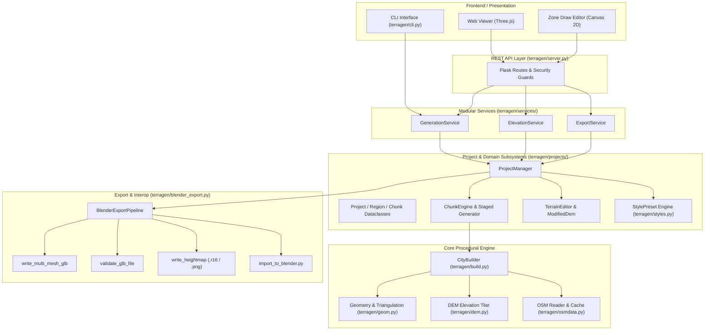

# Terragen World Builder — Developer Guide

This document provides a comprehensive technical reference for engineers extending, maintaining, or integrating with **Terragen 2.1.0**.

---

## 1. System Architecture

Terragen separates presentation, business logic, geographic sampling, procedural geometry generation, and asset serialization into distinct layers:



---

## 2. Module Responsibilities

| Module / Package | Primary Responsibility |
| :--- | :--- |
| [`terragen/projects/model.py`](file:///Users/morarucatalin/Documents/Git/Generare-Orase-3D/terragen/projects/model.py) | Strongly-typed dataclasses for `Project`, `Region`, `ChunkItem`, `ChunkGrid`, `TerrainSettings`, `CoordinateSystem`. |
| [`terragen/projects/manager.py`](file:///Users/morarucatalin/Documents/Git/Generare-Orase-3D/terragen/projects/manager.py) | CRUD operations, project persistence, atomic file saving, region operations, chunk orchestration. |
| [`terragen/projects/chunks.py`](file:///Users/morarucatalin/Documents/Git/Generare-Orase-3D/terragen/projects/chunks.py) | Chunk grid partitioning, staged chunk generation, owner-chunk building deduplication, seam continuity. |
| [`terragen/projects/migration.py`](file:///Users/morarucatalin/Documents/Git/Generare-Orase-3D/terragen/projects/migration.py) | Schema migrations (`schema_version: 1`), legacy metadata migration, backwards-compatible upgrades. |
| [`terragen/projects/validation.py`](file:///Users/morarucatalin/Documents/Git/Generare-Orase-3D/terragen/projects/validation.py) | Project validation, repair for corrupted JSON fields, and integrity checks. |
| [`terragen/projects/regions.py`](file:///Users/morarucatalin/Documents/Git/Generare-Orase-3D/terragen/projects/regions.py) | Region geometry computation, geodesic area, perimeter, bounding box, polygon hole validation. |
| [`terragen/terrain_editor.py`](file:///Users/morarucatalin/Documents/Git/Generare-Orase-3D/terragen/terrain_editor.py) | Non-destructive terrain modifiers, undo/redo stack, brush falloffs, `ModifiedDem` elevation layer. |
| [`terragen/styles.py`](file:///Users/morarucatalin/Documents/Git/Generare-Orase-3D/terragen/styles.py) | Style presets (`european_town`, `rural`, `forest`, `mountains`), color palettes, spatial vegetation rules. |
| [`terragen/blender_export.py`](file:///Users/morarucatalin/Documents/Git/Generare-Orase-3D/terragen/blender_export.py) | Blender export orchestrator, multi-node GLB writer, binary GLB parser, importer script generator. |
| [`terragen/services/`](file:///Users/morarucatalin/Documents/Git/Generare-Orase-3D/terragen/services/) | Decoupled business logic isolated from Flask (`GenerationService`, `ElevationService`, `ExportService`). |
| [`terragen/build.py`](file:///Users/morarucatalin/Documents/Git/Generare-Orase-3D/terragen/build.py) | Procedural city builder: terrain mesh triangulation, road buffering, building extrusion, roofs. |
| [`terragen/geom.py`](file:///Users/morarucatalin/Documents/Git/Generare-Orase-3D/terragen/geom.py) | Polygon triangulation (ear clipping / earcut), 1D smoothing, mesh normals, bounding boxes. |
| [`terragen/dem.py`](file:///Users/morarucatalin/Documents/Git/Generare-Orase-3D/terragen/dem.py) | Mapzen/Terrarium elevation tile fetching, decoding, bilinear interpolation, local caching. |
| [`terragen/osmdata.py`](file:///Users/morarucatalin/Documents/Git/Generare-Orase-3D/terragen/osmdata.py) | Overpass API downloader and offline `.osm.pbf` extraction parser using `osmium`. |
| [`terragen/export.py`](file:///Users/morarucatalin/Documents/Git/Generare-Orase-3D/terragen/export.py) | GLB/glTF 2.0 single mesh writer, OBJ/MTL writer, 16-bit heightmap binary `.r16` writer. |
| [`terragen/server.py`](file:///Users/morarucatalin/Documents/Git/Generare-Orase-3D/terragen/server.py) | Flask web application, CSRF protection, request validation, and REST API dispatching. |

---

## 3. Project File Format (`project.json` Schema v1)

Projects are persisted in `projects/<slug>_<id>/project.json`.

```json
{
  "schema_version": 1,
  "app_version": "2.1.0",
  "id": "e5c86c83d167414c803bdc2591e30c49",
  "name": "Brasov_Valley",
  "slug": "brasov-valley",
  "description": "Procedural stylized valley project",
  "created_at": "2026-11-06T20:00:00Z",
  "updated_at": "2026-11-06T20:15:00Z",
  "seed": 42,
  "geographic": {
    "center": { "lat": 45.6579, "lon": 25.6012 },
    "bounds": { "south": 45.6489, "west": 25.5883, "north": 45.6669, "east": 25.6141 },
    "elevation_ref": 590.0
  },
  "coordinate_system": {
    "projection": "tmerc",
    "datum": "WGS84",
    "units": "meters",
    "world_origin": { "lat": 45.6579, "lon": 25.6012, "altitude": 590.0 },
    "axis_convention": {
      "engine": "X=East, Y=Up, Z=North",
      "glb": "X=East, Y=Up, Z=-North",
      "blender_target": "X=East, Y=North, Z=Up"
    }
  },
  "dimensions": {
    "size_x_m": 2000.0,
    "size_y_m": 2000.0,
    "height_range_m": { "min": 550.0, "max": 950.0 }
  },
  "terrain": {
    "resolution": 256,
    "dem_zoom": 15,
    "step_m": 7.8125,
    "exaggeration": 1.0,
    "smooth_window": 5,
    "modifiers": [
      {
        "id": "mod_01",
        "op": "raise_lower",
        "center_x": 120.0,
        "center_y": -45.0,
        "radius_m": 80.0,
        "amount_m": 15.0,
        "falloff": "smooth"
      }
    ],
    "undo_stack": []
  },
  "regions": [
    {
      "id": "reg_urban_center",
      "name": "Historic Center",
      "region_type": "urban",
      "color": "#e74c3c",
      "polygon": [[25.598, 45.655], [25.604, 45.655], [25.604, 45.660], [25.598, 45.660], [25.598, 45.655]],
      "holes": [],
      "style_preset": "stylized_european_town",
      "seed": 1001,
      "visible": true,
      "enabled": true,
      "status": "unbuilt"
    }
  ],
  "chunks": {
    "grid": {
      "chunk_size_m": 512.0,
      "rows": 4,
      "cols": 4,
      "world_size_x_m": 2000.0,
      "world_size_y_m": 2000.0
    },
    "items": []
  },
  "generation": {
    "roofs": true,
    "formats": ["glb"],
    "building_palette_seed": 42,
    "road_width_scale": 1.0,
    "detail_level": "medium",
    "style_preset": "stylized_european_town"
  }
}
```

---

## 4. Coordinate System & Map Projection

### Map Projection (`LocalProjection`)
Terragen maps spherical coordinates (WGS84 Lat/Lon in degrees) to local Euclidean Cartesian space $(X, Y)$ in meters centered at $(\text{Lat}_0, \text{Lon}_0)$:

$$\Delta Y = (\text{lat} - \text{lat}_0) \times 111\,320.0$$

$$\Delta X = (\text{lon} - \text{lon}_0) \times 111\,320.0 \times \cos\left(\frac{\text{lat} \cdot \pi}{180}\right)$$

The inverse transformation maps local $(X, Y)$ back to degrees:

$$\text{lat} = \text{lat}_0 + \frac{Y}{111\,320.0}$$

$$\text{lon} = \text{lon}_0 + \frac{X}{111\,320.0 \times \cos\left(\frac{\text{lat} \cdot \pi}{180}\right)}$$

### Axis Mappings Across Environments

| Coordinate Frame | $+X$ | $+Y$ | $+Z$ | Handedness |
| :--- | :--- | :--- | :--- | :--- |
| **Terragen World Core** | East | Up (Elevation) | North | Right-handed |
| **glTF 2.0 Binary Export** | East | Up (Elevation) | -North | Right-handed |
| **Blender Scene** | East | North | Up (Elevation) | Right-handed |
| **Unity Engine** | East | Up (Elevation) | North | Left-handed |

Blender's native glTF importer automatically performs the $-Z \to +Y$ axis conversion during `bpy.ops.import_scene.gltf`.

---

## 5. Chunk Engine Architecture

The chunk subsystem ([`terragen/projects/chunks.py`](file:///Users/morarucatalin/Documents/Git/Generare-Orase-3D/terragen/projects/chunks.py)) manages spatial subdivision:

1. **Grid Calculation**:
   Given world size $W$ and chunk dimension $C$ (default 512 m):
   $$\text{rows} = \lceil W / C \rceil, \quad \text{cols} = \lceil W / C \rceil$$
   Chunk bounds are stored in both projected meters `[min_x, min_y, max_x, max_y]` and geographic degrees `[south, west, north, east]`.

2. **Deterministic Seed Derivation**:
   $$\text{Seed}_{\text{chunk}} = \text{CRC32}\left(\text{Seed}_{\text{world}} \,\|\, \text{chunk\_id} \,\|\, \text{row} \,\|\, \text{col}\right) \pmod{2^{31}-1}$$

3. **Owner-Chunk Principle**:
   Features spanning boundaries (e.g., a building footprint intersecting chunks $(0, 0)$ and $(0, 1)$) compute their polygon centroid:
   $$\text{Owner} = \text{Grid.get\_chunk\_containing}(\text{centroid}.x, \text{centroid}.y)$$
   Only the owning chunk instantiates the 3D building mesh, guaranteeing zero duplicate geometry.

4. **Seam Continuity**:
   Neighboring chunks evaluate elevation along shared edges at identical sample coordinates directly from the continuous `Dem` / `ModifiedDem` elevation layer, ensuring height differences $< 10^{-5}\text{ m}$.

---

## 6. Generation Pipeline

When `ChunkEngine.generate_chunk` or `CityBuilder.build` executes:

1. **Terrain Triangulation**:
   Grid of $(N+1) \times (N+1)$ vertices is evaluated against `dem.heights(lon, lat)`. Triangles are formed with diagonal quad splitting.
2. **Road Ribbon Draping**:
   OSM linear ways tagged with `highway` are resampled at 4m intervals, elevation queried with a 7-sample moving average smoothing window, buffered into 2D polygon strips (`quad_segs=2`), and triangulated using 2D constrained Delaunay / ear-clipping.
3. **Procedural Building Extrusion**:
   Building polygons are simplified according to the active `StylePreset.building.simplification_tol`, extruded vertically from their footprint elevation, and topped with procedural hip, gable, or flat roofs.
4. **Vegetation Scattering**:
   Trees are distributed via Poisson-disc / stratified random sampling across green and forest polygons, strictly excluded from road polygons and building footprints.

---

## 7. Export Pipeline (`BlenderExportPipeline`)

Located in [`terragen/blender_export.py`](file:///Users/morarucatalin/Documents/Git/Generare-Orase-3D/terragen/blender_export.py):

- **Pre-Export Validation**: Validates geographic bounds, projection parameters, modifier stack health, and file permissions before allocating geometry buffers.
- **`write_multi_mesh_glb`**:
  Encodes multiple distinct primitives, nodes, and materials into a single glTF 2.0 container. Each layer (e.g. `terrain`, `roads`, `buildings`) is an unmerged Blender object.
- **`validate_glb_file`**:
  Parses the 12-byte binary header (`0x46546C67`), version (2), total byte length, JSON chunk structure, and iterates all accessors to assert that no bounds contain `NaN` or `Inf`.
- **`write_heightmap`**:
  Outputs both 16-bit raw little-endian binary elevation arrays (`.r16`) and 16-bit PNG displacement maps along with scaling metadata.

---

## 8. Test Suite & Verification

The test suite contains **163 tests** across 31 test modules:

```bash
# Run complete test suite
.venv/bin/pytest

# Run Blender-specific export tests
.venv/bin/pytest tests/test_blender_export.py -v

# Run Project Hygiene checks
.venv/bin/pytest tests/test_project_hygiene.py -v
```

### Headless Blender Test Execution
`tests/test_blender_export.py::test_blender_headless_importer_execution` dynamically locates `/Applications/Blender.app/Contents/MacOS/Blender`, generates a test package, and executes:
```bash
Blender --background --python <export_dir>/import_to_blender.py -- --mode layer
```
The test verifies exit code 0, checks that collections are constructed, and ensures all objects are correctly parented.

---

## 9. Known Limitations & Technical Notes

1. **Large World Monolithic Export**:
   Exporting a $20\text{ km} \times 20\text{ km}$ world as a single monolithic layer takes ~48 minutes due to single-threaded Python extrusion of 37,000 buildings. **For large worlds, Chunk Mode export must be used**.
2. **Unity Automation Scope**:
   Blender is the primary destination. Direct Unity scene graph construction (.unity scene file serialization) is not part of the current scope. Assets should be exported from Blender as FBX or glTF into Unity's `Assets/` directory.
3. **Single-User Workspace**:
   Project JSON files use atomic file writes with `.tmp` swapping, suitable for desktop and local server usage; distributed multi-user concurrent editing is not supported.

