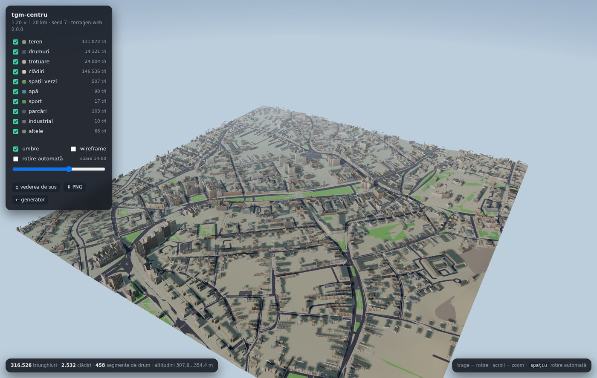
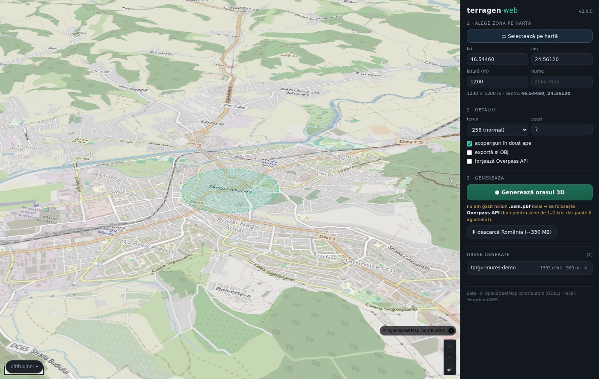

# Terragen World Builder — User Guide

Welcome to **Terragen 2.1.0**, a professional procedural world generator designed to transform real-world geographic data (OpenStreetMap and Digital Elevation Models) into stylized, game-ready 3D environments staged for **Blender** and **Unity**.



---

## Table of Contents
1. [Quick Start](#1-quick-start)
2. [Project Management](#2-project-management)
3. [Selecting Geographic Data](#3-selecting-geographic-data)
4. [Terrain Editing](#4-terrain-editing)
5. [Region Editing](#5-region-editing)
6. [Stylized Presets](#6-stylized-presets)
7. [Chunk Generation](#7-chunk-generation)
8. [Exporting to Blender](#8-exporting-to-blender)
9. [Working in Blender](#9-working-in-blender)
10. [Preparing Assets for Unity](#10-preparing-assets-for-unity)
11. [Troubleshooting & Performance Recommendations](#11-troubleshooting--performance-recommendations)

---

## 1. Quick Start

### Launching Terragen
1. Open your terminal in the Terragen repository root.
2. Run the startup script:
   ```bash
   ./start.sh            # macOS / Linux
   # or on Windows PowerShell:
   .\start.ps1
   ```
3. Open your browser at **http://127.0.0.1:8777**.

---

## 2. Project Management

Terragen uses persistent, versioned projects stored in `projects/<project_slug>_<project_id>/`.

### Creating a Project
1. Navigate to the project dashboard or use the REST API:
   - **Name**: e.g., `Brasov_Valley`
   - **Center Coordinates**: Latitude and Longitude (e.g., `45.6579, 25.6012`)
   - **World Size**: Square side length in meters (e.g., `2000` for 2 km $\times$ 2 km, or `20000` for 20 km $\times$ 20 km).
   - **Terrain Resolution**: Grid density (default `128` or `256`).
2. Click **Create Project**. Terragen initializes `project.json` and computes geographic bounding boxes.

### Project Operations
- **Save / Save As**: Projects auto-save on modifier changes and can be duplicated or renamed at any time.
- **Data & Assets Separation**: Project metadata is stored in `project.json`; large generated 3D meshes are placed in isolated `build/`, `chunks/`, or `exports/` folders so you never accidentally lose project configuration when cleaning generated assets.

---

## 3. Selecting Geographic Data

Terragen integrates two real-world data sources:
1. **Digital Elevation Model (DEM)**: Global Terrarium elevation tiles (~3–5 m/pixel), providing realistic topography.
2. **OpenStreetMap (OSM)**: Real building footprints, street ribbons, pathways, water bodies, and green areas.

### Offline vs. Online Data
- **Online (Overpass API)**: Good for exploratory zones up to 2 km.
- **Offline (`.osm.pbf`)**: Highly recommended for production and large worlds. Download regional packages (such as `romania.osm.pbf`) into the project root for $\sim 10\times$ faster extraction with zero rate limits.

---

## 4. Terrain Editing

Terragen includes a non-destructive, brush-based **Terrain Editor** that sits on top of the original DEM:



### Brushes & Operations
- **Raise / Lower**: Adjust elevation with smooth radial falloffs.
- **Smooth**: Eliminate steep or harsh elevation discontinuities.
- **Flatten**: Level plateaus for airports, city squares, or industrial parks.
- **Hills & Valleys**: Procedurally blend Gaussian mounds or river depressions.
- **Water Excavation**: Carve lake basins below the water table.

### Non-Destructive Modifiers & Undo
Every stroke is stored in an undo stack. You can undo (`Ctrl+Z`), redo (`Ctrl+Y`), or clear operations at any time without degrading the underlying raw DEM source.

---

## 5. Region Editing

The **Region Editor** allows you to draw arbitrary 2D polygon boundaries across the world map (`/ui/zone-draw.html`):

### Region Types
- **Urban**: Dense downtown, masonry facades, high-density procedural roofs.
- **Suburban**: Residential housing, pitched tile roofs, gardens.
- **Industrial**: Flat metal roofs, warehouse proportions, concrete yards.
- **Forest**: Heavy foliage scattering with slope and elevation rules.
- **Grassland**: Open prairies and meadow palettes.
- **Mountain**: Rocky terrain gradients, elevation snowcaps, zero tree distribution on steep slopes.
- **Agricultural**: Field geometries and crop palettes.
- **Water**: Lake and river exclusion zones.
- **Custom**: User-defined color palettes and densities.

### Editing Capabilities
- **Draw**: Click to define boundary vertices. Double-click or click the first vertex to close the loop.
- **Holes**: Draw exclusion rings inside a parent region (e.g., an urban park inside a downtown district).
- **Style Assignment**: Assign dedicated visual presets (`european_town`, `rural`, `forest`, `mountains`) per region.
- **Independent Seed**: Every region has an isolated random seed; modifying one region regenerates only that region.

---

## 6. Stylized Presets

Terragen includes built-in stylized aesthetic presets designed for hand-crafted low-poly visuals:

1. **Stylized European Town (`stylized_european_town`)**:
   - Roof Profiles: Mansard and dual-pitch gable roofs.
   - Palette: Terracotta red, warm amber, cream facades.
   - Asphalt: Dark charcoal streets with sidewalk curbs.
2. **Stylized Rural (`stylized_rural`)**:
   - Building Heights: Low 1–2 story dwellings with high gable pitches.
   - Palette: Earthy tones, timber textures, dirt roads.
3. **Stylized Forest (`stylized_forest`)**:
   - Vegetation: High tree density with procedural scale variation ($\pm 35\%$).
   - Exclusion: Strict spatial exclusion from roads and buildings.
4. **Stylized Mountains (`stylized_mountains`)**:
   - Dynamic Elevation Shading: Rock slopes transitioning to snowcaps above threshold altitudes.

---

## 7. Chunk Generation

For large maps (up to $20\text{ km} \times 20\text{ km}$), Terragen divides the world into manageable square chunks (default $512\text{ m} \times 512\text{ m}$).

### Deterministic Generation
- Every chunk seed is derived cryptographically from `World_Seed + Chunk_Row + Chunk_Col`.
- Regenerating a chunk produces an identical result unless region settings or DEM modifiers change.

### Boundary Continuity
- **Terrain Seams**: Edge vertices share exact elevation values ($< 10^{-5}\text{ m}$ difference), ensuring zero visible cracks.
- **Road Continuity**: Road ribbons crossing chunk borders align with sub-millimeter precision.
- **Building Deduplication**: The **Owner-Chunk Principle** assigns buildings that cross chunk borders to a single owning chunk, preventing duplicate meshes.

---

## 8. Exporting to Blender

Terragen provides a dedicated **Professional Blender Export Pipeline**:

### Export Modes
1. **Layer Mode (`mode: "layer"`)**:
   - Exports the entire world into category-specific GLB files:
     - `layers/terrain.glb`
     - `layers/buildings.glb`
     - `layers/roads.glb`
     - `layers/vegetation.glb`
     - `layers/water.glb`
2. **Chunk Mode (`mode: "chunk"`)**:
   - Exports each chunk into `chunks/chk_rXX_cYY/chunk.glb` with unmerged sub-layers.
3. **Both (`mode: "both"`)**:
   - Exports both layer files and chunk folders simultaneously.

### Additional Artifacts Generated
- `heightmap/terrain_heightmap_16bit.png`: 16-bit PNG displacement map.
- `heightmap/terrain_heightmap_257.r16`: Raw unsigned 16-bit little-endian binary elevation.
- `regions/regions.geojson`: Vector boundaries with all metadata properties and tags.
- `blender_manifest.json`: Complete geographic, bounding, and layer manifest.
- `import_to_blender.py`: Automated Blender importer.

---

## 9. Working in Blender

### Importing the World
1. Open Blender (v3.6 LTS, v4.x, or v5.x LTS).
2. Open the **Scripting** workspace.
3. Open `import_to_blender.py` from your export directory and click **Run Script** (or run from terminal):
   ```bash
   blender --python <export_dir>/import_to_blender.py -- --mode layer
   ```

### What the Importer Does Automatically:
- **Collection Tree**: Builds `Terragen_<Project_Name>` root with clean subcollections (`Layer_Terrain`, `Layer_Buildings`, etc.).
- **50 km Viewport Clipping**: Adjusts 3D Viewport `clip_end` to $50,000\text{ m}$ so massive worlds are instantly visible without clipping.
- **Material Deduplication**: Consolidates duplicate shader slots (`mat_terrain.001` $\to$ `mat_terrain`) to maintain a clean shader graph.
- **1:1 Meter Scale**: Terragen meters import directly as Blender units (no manual scaling required).

---

## 10. Preparing Assets for Unity

> [!NOTE]
> Blender is the primary destination and staging area. Once lighting, custom props, and materials are finalized in Blender, use the following workflow to export to Unity:

1. **Hierarchy Organization**:
   - Keep objects parented under their respective Terragen collections.
   - Mark static geometry (terrain, buildings, roads) as Static in Unity for occlusion culling and batching.
2. **FBX / glTF Unity Export**:
   - In Blender: `File` $\to$ `Export` $\to$ `glTF 2.0 (.glb)` or `FBX (.fbx)`.
   - Settings:
     - Forward: $-Z$ Forward, Up: $+Y$ Up.
     - Apply Scalings: `FBX All`.
3. **Terrain Heightmap in Unity**:
   - Create a Unity `Terrain` GameObject.
   - In Terrain Settings $\to$ *Import Raw...*:
     - Select `terrain_heightmap_257.r16`.
     - Depth: `16 Bit`.
     - Byte Order: `Windows / Little-Endian`.
     - Set Terrain Width/Length to project dimensions ($2000\text{ m}$) and Height to `elevation_range` from `terrain_heightmap.json`.

---

## 11. Troubleshooting & Performance Recommendations

| Issue | Cause | Solution |
| :--- | :--- | :--- |
| **Monolithic 20km export takes a long time** | Generating a single mesh with 37,000 buildings is CPU-heavy. | Use **Chunk Mode** export or export layers selectively (`--layers terrain,roads`). |
| **Objects disappear when zooming out in Blender** | Blender default viewport clip is 1,000 m. | Press `N` in 3D Viewport $\to$ `View` $\to$ set `End` to `50000m` (done automatically by `import_to_blender.py`). |
| **Streets clipping through terrain** | Steep slope road draping. | Apply a small Smooth brush in the Terrain Editor along steep road segments before exporting. |
| **Overpass API timeout** | Public Overpass servers throttled. | Download the regional `.osm.pbf` file (e.g. `romania.osm.pbf`) for instant offline extraction. |

